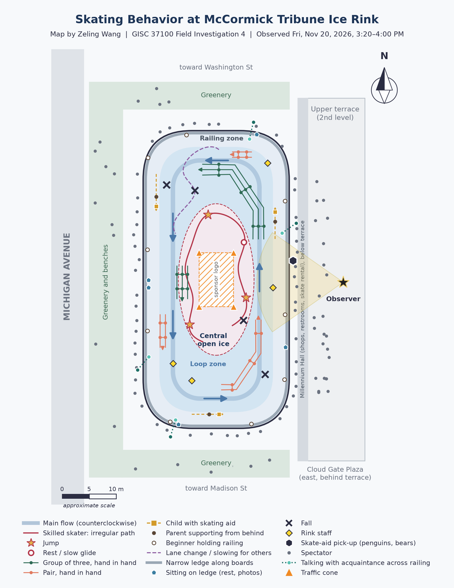

# Skating Behavior at McCormick Tribune Ice Rink

This repository contains the Python code and map created for Field Investigation 4 in GISC 37100: Cartographic Design and Geovisualization at the University of Chicago.

The map visualizes skating behavior at the McCormick Tribune Ice Rink in Millennium Park, Chicago, based on a 40-minute field observation on November 20, 2026 (3:20–4:00 PM). Drawing on the mapping, tracing, and photographing methods described by Gehl and Svarre (2013), it illustrates how skaters of different skill levels and social groupings use and move through the rink.

## Files

- `rink_map.ipynb` — Jupyter notebook containing the code used to create the map, organized by map layer.
- `rink_map.png` — Final map output. A PDF version can also be generated from the notebook.

## How to Run

Open `rink_map.ipynb` in Jupyter Notebook and run all cells to generate the map in PNG and PDF formats.

## Reference

Gehl, J., & Svarre, B. (2013). *How to study public life*. Island Press.
